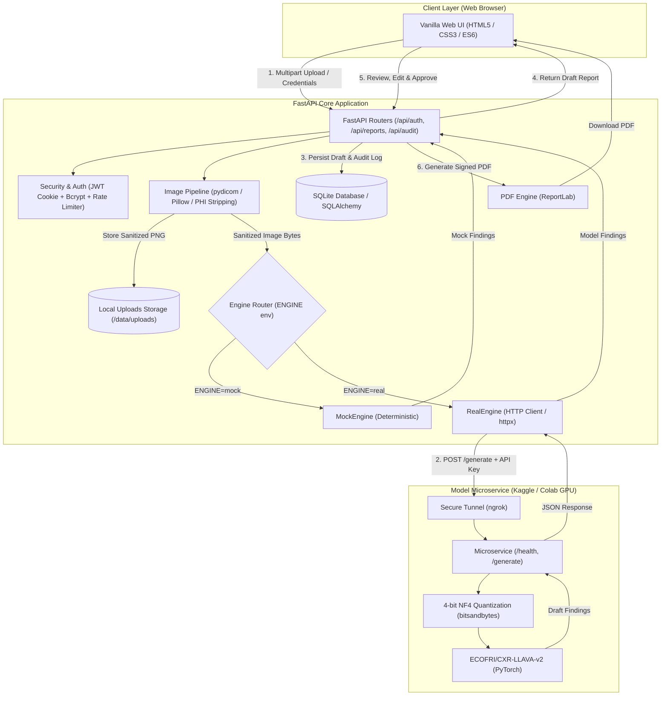

# XRay Report AI

[](https://www.python.org/downloads/)
[](https://fastapi.tiangolo.com)
[](https://www.sqlalchemy.org/)
[](https://pytorch.org/)
[](https://huggingface.co/ECOFRI/CXR-LLAVA-v2)
[](https://creativecommons.org/licenses/by-nc/4.0/)

> ⚠️ **IMPORTANT CLINICAL SAFETY NOTICE**  
> **AI-generated DRAFT. Must be reviewed and approved by a qualified radiologist. Not a final diagnosis.**  
> This software is an assistive tool designed strictly for preliminary draft generation and clinical review workflow. It never provides an automated or autonomous final diagnosis.

---

## 📋 Overview

**XRay Report AI** is a clinical assistant platform designed to accelerate radiology workflows while preserving physician oversight. When a clinician uploads a frontal chest radiograph (DICOM, PNG, or JPEG), the system processes the image, strips all patient identifiers, and queries a dedicated multimodal vision-language model (`ECOFRI/CXR-LLAVA-v2`) or a deterministic mock engine to produce a **preliminary draft report** (Findings).

The attending radiologist reviews the AI draft, edits findings, drafts clinical impressions, and formally **approves** the record. Once approved, the report is cryptographically locked against further modifications and can be exported as an official, tamper-evident PDF clinical report.

### Core Philosophy: Human-in-the-Loop
1. **AI Proposes, Physician Disposes**: The AI model only drafts preliminary descriptive findings.
2. **Clinical Impression is Physician-Owned**: The model leaves the "Impression" section empty, requiring the radiologist's clinical synthesis.
3. **Immutability After Approval**: Once signed off, report records cannot be altered or overwritten.
4. **Strict Auditability**: Every login, draft creation, image viewing, text modification, approval, and PDF download is logged to a persistent audit trail.

---

## ✨ Key Features

- **🛡️ Secure DICOM & Image Sanitization Pipeline**
  - Ingests medical DICOM (`.dcm`), PNG, and JPEG files up to 20 MB.
  - Automatically de-identifies DICOM files by extracting only essential technical acquisition tags (e.g., `Modality`, `BodyPartExamined`, `PhotometricInterpretation`) and stripping all Protected Health Information (PHI) tags before storage.
  - Supports automatic grayscale normalization and `MONOCHROME1` to `MONOCHROME2` photometric inversion.
  - Automatically resizes high-resolution studies to standard 1024×1024 grayscale PNG representations.

- **🔌 Pluggable Dual-Engine Architecture**
  - **`MockEngine`**: Deterministic, offline engine for unit testing, CI/CD, and local development without GPU requirements.
  - **`RealEngine`**: Robust HTTP client connecting to an external GPU-accelerated model microservice running `ECOFRI/CXR-LLAVA-v2`. Features 180s timeout handling, ngrok header forwarding, and graceful HTTP 502 error mapping for model service timeouts and OOM states.

- **👨‍⚕️ Radiologist Review & Sign-Off Workflow**
  - Side-by-side view showing the ingested radiograph alongside editable Findings and Impression text areas.
  - Preserves both original AI-generated text (`ai_findings`, `ai_impression`) and physician-edited text (`final_findings`, `final_impression`).
  - Approval state locks the report to prevent subsequent tampering.

- **📄 Tamper-Evident PDF Export**
  - Generates standardized clinical reports using ReportLab.
  - Features an embedded thumbnail of the radiograph, study metadata, original filename, and timestamp.
  - Displays physician attestation credentials and prominent mandatory regulatory disclaimers.
  - Watermarks mock or unapproved states cleanly.

- **🔒 Enterprise Security & Access Control**
  - **Role-Based Access Control (RBAC)**: Distinguishes between `doctor` (can create, edit own drafts, and approve) and `admin` (can view audit logs and manage all reports).
  - **Secure Sessions**: Issues signed JWT access tokens stored in `HttpOnly`, `SameSite=Lax` browser cookies.
  - **Brute-Force Protection**: Enforces an in-memory rate-limiter locking accounts for 60 seconds after 5 consecutive failed login attempts.
  - **Tamper-Evident Audit Logging**: Tracks user IDs, IP context, action timestamps, report IDs, and operation categories (`login`, `created`, `viewed`, `edited`, `approved`, `pdf_exported`).

- **⚡ Zero-Build Lightweight Frontend**
  - Built entirely with vanilla HTML5, CSS3, and ES6 JavaScript.
  - Zero dependencies, zero build steps, and zero external CDN requirements for air-gapped hospital intranet compatibility.

---

## 🏗️ Architecture & AI Workflow



---

## 💻 Tech Stack

| Component | Technologies | Description |
| :--- | :--- | :--- |
| **Backend Framework** | [FastAPI](https://fastapi.tiangolo.com/) (Python 3.11+) | High-performance asynchronous REST API framework |
| **Server Engine** | [Uvicorn](https://www.uvicorn.org/) | Lightning-fast ASGI web server |
| **Database & ORM** | [SQLite](https://www.sqlite.org/) + [SQLAlchemy](https://www.sqlalchemy.org/) | Embedded relational storage with declarative ORM models |
| **Image Processing** | [Pillow](https://python-pillow.org/) + [pydicom](https://pydicom.github.io/) | Medical DICOM parsing, pixel normalization, and format conversion |
| **PDF Generation** | [ReportLab](https://www.reportlab.com/) | Programmatic, high-resolution vector clinical PDF synthesis |
| **Security & Auth** | [PyJWT](https://pyjwt.readthedocs.io/), [bcrypt](https://pypi.org/project/bcrypt/) | Password hashing, JWT signing, and secure cookie handling |
| **HTTP Client** | [HTTPX](https://www.python-httpx.org/) | Asynchronous / synchronous HTTP client with streaming & timeout controls |
| **Frontend UI** | HTML5, CSS3, ES6 JavaScript | Zero-framework, zero-build, CDN-free responsive user interface |
| **Deep Learning** | [PyTorch](https://pytorch.org/), [Transformers](https://huggingface.co/docs/transformers), [bitsandbytes](https://github.com/TimDettmers/bitsandbytes) | 4-bit quantized vision-language inference on NVIDIA GPUs |
| **Test Suite** | [pytest](https://docs.pytest.org/) | Comprehensive integration and unit test coverage |

---

## 📂 Project Structure

```text
x-ray/
├── .env.example              # Template configuration variables
├── AGENTS.md                 # Project operational & clinical safety rules
├── pytest.ini                # Pytest configuration and test path definitions
├── README.md                 # Project technical documentation
├── requirements.txt          # Production and testing Python dependencies
├── app/
│   ├── config.py             # Pydantic Settings application configuration
│   ├── db.py                 # SQLAlchemy SQLite database session setup
│   ├── main.py               # FastAPI application lifecycle and router registration
│   ├── models.py             # Database models (User, Report, AuditLog)
│   ├── schemas.py            # Pydantic request/response validation schemas
│   ├── security.py           # Password hashing, JWT generation, and auth dependencies
│   ├── api/                  # Deprecated route stubs (migrated to app/routers)
│   ├── routers/
│   │   ├── audit.py          # Admin audit log query endpoints
│   │   ├── auth.py           # Login, logout, and credential verification endpoints
│   │   └── reports.py        # Report upload, retrieval, editing, approval, and PDF export
│   ├── services/
│   │   ├── audit.py          # Audit trail helper utility
│   │   ├── image_utils.py    # DICOM validation, PHI stripping, and PNG conversion
│   │   ├── pdf_export.py     # ReportLab clinical document synthesis
│   │   └── engines/
│   │       ├── base.py       # Abstract base class for AI report engines
│   │       ├── mock.py       # Deterministic mock report generator
│   │       └── real.py       # Remote GPU microservice HTTP client
│   └── static/
│       ├── app.js            # Frontend application logic (upload, edit, approve, PDF)
│       ├── audit.html        # Administrative audit log viewer
│       ├── index.html        # Main clinical workspace UI
│       ├── login.html        # Secure authentication portal
│       └── styles.css        # Clinical-grade styling and responsive layout
├── data/
│   ├── app.db                # SQLite database file (created on launch)
│   └── uploads/              # Storage directory for sanitized radiograph PNGs
├── model_service/
│   ├── NOTES.md              # Upstream model architecture and loading notes
│   ├── README.md             # Kaggle / Google Colab GPU deployment guide
│   ├── requirements.txt      # Model service dependencies (transformers<4.40.0)
│   └── server.py             # Standalone FastAPI microservice for ECOFRI/CXR-LLAVA-v2
├── scripts/
│   ├── create_user.py        # CLI utility for provisioning doctor/admin users
│   └── run_browser_qa.py     # Automated browser testing utility
└── tests/
    ├── conftest.py           # Pytest test isolation fixtures (ENGINE=mock default)
    ├── test_audit.py         # Audit logging tests
    ├── test_auth.py          # Authentication and brute-force lockout tests
    ├── test_engines.py       # Mock and Real engine unit tests
    ├── test_health.py        # Healthcheck endpoint tests
    ├── test_image_utils.py   # DICOM parsing, sanitization, and PNG conversion tests
    ├── test_model_service.py # Model service endpoint validation tests
    ├── test_pdf.py           # PDF generation and permission validation tests
    └── test_reports.py       # Full report lifecycle integration tests
```

---

## ⚙️ Prerequisites & Installation

### Prerequisites
- **Python**: Version `3.11` or higher installed.
- **Operating System**: Linux, macOS, or Windows (PowerShell supported).
- **GPU (Optional)**: NVIDIA GPU with CUDA support required only if running the `model_service` locally. For standard backend development, CPU execution with `ENGINE=mock` is recommended.

### 1. Clone the Repository
```bash
git clone https://github.com/<your-username>/x-ray.git
cd x-ray
```

### 2. Set Up Virtual Environment

**On Windows (PowerShell):**
```powershell
python -m venv .venv
.\.venv\Scripts\Activate.ps1
pip install -r requirements.txt
```

**On Linux / macOS:**
```bash
python3 -m venv .venv
source .venv/bin/activate
pip install -r requirements.txt
```

### 3. Configure Environment Variables
Copy `.env.example` to `.env`:
```bash
cp .env.example .env
```
Ensure required values are set in `.env` (refer to the configuration table below).

### 4. Create an Initial User Account
Provision an initial doctor or administrator account using the secure CLI script:
```bash
python scripts/create_user.py --username dr_smith --role doctor
python scripts/create_user.py --username admin_user --role admin
```
*(You will be securely prompted to enter and confirm a password).*

---

## 🔧 Environment Configuration

| Variable | Type | Default | Description |
| :--- | :--- | :--- | :--- |
| `APP_NAME` | `str` | `"XRay Report AI"` | Application title displayed across headers and PDFs |
| `DATABASE_URL` | `str` | `"sqlite:///./data/app.db"` | SQLAlchemy connection string |
| `UPLOAD_DIR` | `str` | `"./data/uploads"` | Filesystem directory storing normalized radiographs |
| `MAX_UPLOAD_MB` | `int` | `20` | Maximum allowable upload file size in megabytes |
| `ENGINE` | `str` | `"mock"` | Report engine selection: `mock` (deterministic) or `real` (GPU microservice) |
| `SECRET_KEY` | `str` | *None* | Cryptographic secret key used to sign JWT session cookies |
| `MODEL_SERVICE_URL` | `str` | `""` | Base URL of the GPU model service (e.g. `https://<id>.ngrok-free.app`) |
| `MODEL_SERVICE_KEY` | `str` | `""` | API key required in `X-API-Key` header by the model microservice |

---

## 🚀 Running the Application

### 1. Start the FastAPI Server
```bash
uvicorn app.main:app --host 127.0.0.1 --port 8000 --reload
```

### 2. Access the Application
- **Login Portal**: Open [http://127.0.0.1:8000/login.html](http://127.0.0.1:8000/login.html) and sign in using your created credentials.
- **Radiologist Workspace**: [http://127.0.0.1:8000/](http://127.0.0.1:8000/)
- **Audit Logs** *(Admin only)*: [http://127.0.0.1:8000/audit.html](http://127.0.0.1:8000/audit.html)
- **Interactive OpenAPI Docs**: [http://127.0.0.1:8000/docs](http://127.0.0.1:8000/docs)

### 3. Run the Automated Test Suite
Execute the entire test suite covering unit tests, image sanitization, security, and lifecycle flows:
```bash
pytest -v
```

---

## 🤖 AI Model Microservice Deployment

For live clinical drafting, deploy `model_service/` on a GPU-enabled platform such as **Kaggle** or **Google Colab** (NVIDIA T4 or P100 with at least 14 GB VRAM).

### Optimized 4-bit Quantization
The service loads `ECOFRI/CXR-LLAVA-v2` in 4-bit NF4 quantization using `bitsandbytes` and `torch.inference_mode()`. This drops memory requirements from 14.2 GiB to **~4.2 GiB VRAM**, eliminating out-of-memory crashes on free T4 GPU instances.

### Step-by-Step Deployment (Kaggle Notebook)
1. Create a Kaggle notebook with **GPU T4 x2** accelerator and **Internet On**.
2. Install pinned dependencies:
   ```bash
   !pip install "transformers<4.40.0" accelerate bitsandbytes fastapi uvicorn pyngrok python-multipart pillow
   ```
3. Upload `model_service/server.py` and run:
   ```python
   import os
   from pyngrok import ngrok
   import uvicorn

   os.environ["MODEL_SERVICE_KEY"] = "your-secure-service-key"
   ngrok.set_auth_token("YOUR_NGROK_AUTHTOKEN")
   tunnel = ngrok.connect(8000)
   print(f"Public URL: {tunnel.public_url}")

   !uvicorn server:app --host 0.0.0.0 --port 8000
   ```
4. Update your local `.env`:
   ```env
   ENGINE=real
   MODEL_SERVICE_URL=https://<your-ngrok-id>.ngrok-free.app
   MODEL_SERVICE_KEY=your-secure-service-key
   ```
5. Restart your local web server. All uploads will now generate drafts using the live CXR-LLaVA model.

---

## 📡 API Reference

### Authentication Endpoints (`/api/auth`)

| Method | Endpoint | Access | Description |
| :--- | :--- | :--- | :--- |
| `POST` | `/api/auth/login` | Public | Authenticates user credentials, applies rate-limiting, and sets JWT cookie |
| `POST` | `/api/auth/logout` | Authenticated | Clears the JWT session cookie |
| `GET` | `/api/auth/me` | Authenticated | Returns current authenticated user metadata |

### Reports Endpoints (`/api/reports`)

| Method | Endpoint | Access | Description |
| :--- | :--- | :--- | :--- |
| `POST` | `/api/reports` | Doctor / Admin | Uploads radiograph, sanitizes image, generates draft, and stores record |
| `GET` | `/api/reports` | Authenticated | Lists all existing report records ordered by creation date |
| `GET` | `/api/reports/{id}` | Authenticated | Retrieves detailed record for a specific report |
| `GET` | `/api/reports/{id}/image`| Authenticated | Streams the sanitized grayscale PNG image |
| `PUT` | `/api/reports/{id}` | Creator / Admin | Updates `final_findings` and `final_impression` (draft status only) |
| `POST` | `/api/reports/{id}/approve` | Creator / Admin | Finalizes report, records timestamp, and locks from further edits |
| `GET` | `/api/reports/{id}/pdf` | Authenticated | Generates and exports official clinical PDF (approved status only) |

### Audit & System Endpoints

| Method | Endpoint | Access | Description |
| :--- | :--- | :--- | :--- |
| `GET` | `/api/audit` | Admin Only | Retrieves the most recent 200 system audit log entries |
| `GET` | `/api/health` | Public | System health check (`{"status": "ok"}`) |

---

## 🧑‍⚕️ Radiologist Review Workflow

```text
[1. Ingest Study] ──> [2. Safe Normalization] ──> [3. Draft Generation]
         │                       │                         │
         ▼                       ▼                         ▼
  DICOM / PNG / JPG      Strip PHI & Resize        CXR-LLaVA Generates
                         to Grayscale PNG          Preliminary Findings
                                                           │
                                                           ▼
[6. Clinical PDF] ◄── [5. Sign-Off & Lock]   ◄── [4. Radiologist Review]
         │                       │                         │
         ▼                       ▼                         ▼
Tamper-Evident Report    Status -> "approved"      Doctor modifies Findings,
with Credentials         Subsequent Edits Blocked  enters Impression
```

1. **Upload**: Clinician selects or drags a chest X-ray file.
2. **De-Identification**: DICOM headers containing patient names or MRNs are stripped; image is converted to a normalized PNG.
3. **Draft Synthesis**: AI generates descriptive findings (e.g., lung expansion, cardiac silhouette, pleural spaces).
4. **Physician Editing**: The radiologist evaluates the findings against the study, corrects any hallucinations or omissions, and authors the diagnostic impression.
5. **Approval**: Clicking "Approve Report" locks the report state.
6. **PDF Download**: An approved report can be downloaded or printed for the electronic medical record (EMR).

---

## 🧠 AI Model Details & Limitations

- **Underlying Architecture**: `ECOFRI/CXR-LLAVA-v2` combines a vision encoder (CLIP/BiomedCLIP) with a fine-tuned Meta LLaMA-2-7B language model trained on paired radiograph-report corpora.
- **Scope**: Specialized specifically for frontal chest radiographs (PA and AP projections). Not suited for lateral views, CT, MRI, or non-thoracic imaging.
- **Findings Only**: The model is trained to output descriptive visual observations. It does not synthesize clinical impressions or treatment recommendations.
- **Known Limitations**:
  - Susceptible to vision-language hallucinations (e.g., reporting a normal cardiac silhouette in the presence of mild cardiomegaly, or missing subtle apical pneumothoraces).
  - Susceptible to language generation repetition when handling complex foreign artifacts (e.g., pacemaker leads or surgical clips).
  - Must never be used as a standalone diagnostic system.

---

## 🛡️ Security, Privacy & Compliance

- **HIPAA-Oriented Privacy by Design**: Real patient data is never accepted in this repository. All uploaded DICOMs are parsed via `pydicom` with selective tag whitelisting, preventing accidental persistence of names, birth dates, or accession numbers.
- **Cryptographic Storage**: User passwords are encrypted with individual salts using `bcrypt`.
- **JWT Protection**: Session cookies are marked `HttpOnly` (inaccessible via JavaScript `document.cookie`) and `SameSite=Lax` to mitigate Cross-Site Scripting (XSS) and Cross-Site Request Forgery (CSRF).
- **Brute-Force Lockout**: Rate-limiting shields the login API against automated dictionary attacks.
- **Report Immutability**: Business logic enforces that once `status == "approved"`, `PUT /api/reports/{id}` strictly rejects updates with `409 Conflict`.

---

## ⚖️ Licensing & Terms of Use

- **Source Code**: Released under the [MIT License](LICENSE) for the application framework.
- **AI Model Weights**: `ECOFRI/CXR-LLAVA-v2` is distributed under the Creative Commons Non-Commercial ([CC BY-NC 4.0](https://creativecommons.org/licenses/by-nc/4.0/)) license and subject to the [Meta LLaMA-2 Community License](https://ai.meta.com/resources/models-and-libraries/llama-downloads/).
- **Commercial Restriction**: This software cannot be deployed for commercial services or revenue-generating clinical operations without explicit upstream commercial licensing from the respective model and base LLM authors.

---

## 🩺 Medical Disclaimer

```text
================================================================================
                              CLINICAL DISCLAIMER
================================================================================
AI-generated DRAFT. Must be reviewed and approved by a qualified radiologist.
Not a final diagnosis.

This software is an experimental draft generation tool intended solely for
educational, research, and assistive workflow evaluation. It has not been
cleared, certified, or approved by the United States Food and Drug Administration
(FDA), the European Medicines Agency (EMA), or any other regulatory authority
for medical diagnosis or clinical decision support.

The authors and contributors assume no liability for medical decisions,
clinical errors, omissions, or patient outcomes resulting from the use of this
software.
================================================================================
```

---

## 🔮 Roadmap & Enterprise Extensions

- [ ] **DICOMweb & PACS Integration**: Direct support for `WADO-RS` / `STOW-RS` / `QIDO-RS` endpoints to pull studies directly from hospital PACS.
- [ ] **Enterprise Database Support**: Migration adapters for PostgreSQL and S3-compatible object storage (AWS S3, Google Cloud Storage, MinIO).
- [ ] **HL7 FHIR & DICOM SR Export**: Structured reporting export complying with `DiagnosticReport` FHIR resource standards.
- [ ] **Automated Dockerization**: Multi-stage `Dockerfile` and `docker-compose.yml` configurations for isolated on-premise container deployment.
- [ ] **Multi-View Ingestion**: Support for paired PA and Lateral chest views to improve retrocardiac and pleural space analysis.
